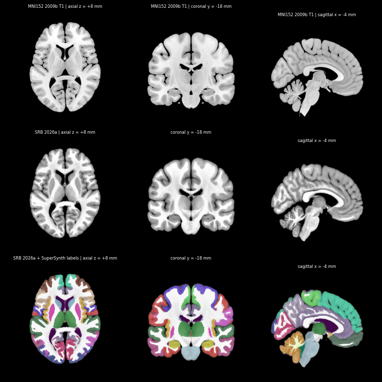

# Synchrotron Reference Brain (SRB)

Cohort-averaged synchrotron tomography (HiP-CT) of the adult human brain, in MNI152 2009b space.

**SRB 2026a** is a 100 µm template averaged from 10 post-mortem brains. SRB 2026b (50 µm) and SRB 2026c (20 µm) are to follow.

## View it

**[Open in Neuroglancer](https://neuroglancer-demo.appspot.com/#!https://storage.googleapis.com/hip_ct_zarr_vector_03987646472fethdsvdvdfg/zarr_vectors_test/cohort_MNI2009b_2026/SRB2026a_neuroglancer_state.json)**

| Layer | Voxel size |
| --- | --- |
| MNI152 2009b T1 | 500 µm |
| SRB 2026a template | 100 µm |
| SuperSynth labels, MNI | 500 µm |
| SuperSynth labels, SRB 2026a | 500 µm |

The label layers start hidden; switch them on in the layer list. Their colours follow the FreeSurfer lookup table, with cortex split into 17 gyral groups per hemisphere.

## How it was made

1. Each brain's SuperSynth and SynthSeg labels were registered to MNI's labels.
2. The 10 brains were then co-registered on image intensity into an unbiased template, from 1.6 mm down to 200 µm.
3. Each brain was resampled once from its 50–65 µm scan, and the brains were averaged with similarity weights and 2σ clipping.
4. The template was masked to the cohort's brain outline, to remove dura and connective tissue.

The volumes are OME-Zarr files in a public Google Cloud bucket; the link above opens all of them.

